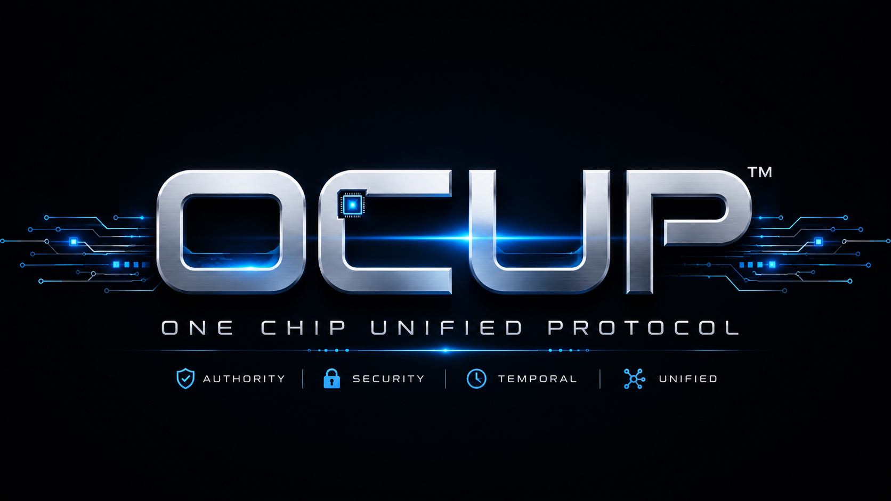

<div align="center">



# QSAFP Open Core

### An OCUP-aligned reference surface for Temporal Authority Governance

**If it moves, if it transacts, or if it decides—its authority should be bounded.**

[OCUP.ai](https://ocup.ai) · [QSAFP.org](https://qsafp.org) · [Architecture](ARCHITECTURE.md) · [Security](SECURITY.md)

</div>

---

## The governing invariant

> **The governed system cannot authorize, extend, restore, or enlarge its own operation.**

OCUP—the **One Chip Unified Protocol**—is a proposed substrate for bounding machine authority across AI, robotics, autonomous systems, and high-consequence digital infrastructure.

QSAFP is the open-core reference lineage through which time-bounded authority, validator-mediated authorization, fail-closed expiration, and evidence generation have been explored in software. It is being aligned beneath OCUP as a public reference and integration surface.

The objective is narrow: advanced systems may perform powerful work, but they must not possess unilateral authority to continue, renew, recover, or expand their own operation.

## What this repository is

This repository contains legacy and experimental QSAFP materials, including:

- illustrative C components for leases, sessions, consensus, and hardware-abstraction interfaces;
- firmware stubs and local demonstrations;
- JavaScript and Python simulations;
- test records and historical benchmark artifacts;
- QVN and inference-continuum demonstrations; and
- public architecture and integration documentation.

These materials support research, review, and reproducible exploration. They are **not a production safety controller**, certified system, deployed validator network, hardware root of trust, or complete OCUP implementation.

## Authority model

A governed operation is allowed only when the required authority inputs are valid for the requested time and capability scope.

```text
Human / institutional authority
              │
              ▼
Fresh validator decision ──────► Evidence record
              │
              ▼
Temporal authority state
              │
              ▼
Capability gate ───────────────► Governed resource
              │
       expiry / revoke /
      quarantine / fault
              ▼
        deny or reduce
```

The intended architecture separates:

1. **Authority source** — authorized human or institutional actors.
2. **Decision** — fresh, authenticated validator approval under a defined quorum policy.
3. **Temporal state** — bounded duration, scope, lifecycle identity, and continuity conditions.
4. **Enforcement** — a gate controlling access to a governed capability.
5. **Evidence** — tamper-evident records of grants, denials, expiry, revocation, and state transitions.

A host, model, agent, or governed workload is not a trusted source of renewal, enlargement, successor activation, or restoration authority.

## Evidence and implementation status

| Surface | Current status | Claim boundary |
|---|---|---|
| Legacy C, JavaScript, and Python materials in this repository | Public experimental code and demonstrations | Software reference behavior; not non-bypassable hardware enforcement |
| OCUP Rust control-plane reference | Developed and tested in a separate implementation program | Software enforcement and deterministic evidence; not a hardware root of trust |
| FPGA Milestones 1–3 | Simulation and bounded verification completed in a separate private RTL program | Verified RTL behavior in the stated test environments; not yet physical-board proof |
| M4 lifecycle / fresh-authority work | Proof closure and integration verification in progress | No public production or non-bypassability claim |
| AMD Kria KR260 board validation | Planned next-stage bench work | Physical-board results not yet claimed |
| Production trust services | Future integration work | HSM/secure-element custody, trusted monotonic time, remote attestation, and distributed validators are not provided here |

Historical benchmark and threat-classification files remain part of the repository record. They must be interpreted within their original software-test scope and do not establish production readiness, universal threat detection, hardware enforcement, or current OCUP performance.

## Fail-closed does not mean “kill switch”

OCUP is designed around **fail-safe authority reduction**, not an indiscriminate remote destruction mechanism.

Depending on the governed capability and safety policy, expiration or loss of valid authority may produce denial, quarantine, restricted local operation, safe positioning, or another bounded state. The invariant is that disruption must not expand authority or allow the governed system to reauthorize itself.

## QVN and fresh authority

The QVN concept provides a human-validator pattern for authorization decisions. Current reference work models bounded quorum, freshness, replay resistance, partition behavior, quarantine, and auditable decisions.

A subsequent lease is treated as a new authority transaction. Preauthorization, host-supplied identifiers, cached approval, or a successor request must not silently bridge an expired authority interval.

## Related OCUP layers

### RAAVE

RAAVE is a complementary OCUP-aligned architecture for hardware-rooted machine identity, lifecycle authorization, temporal compliance signaling, and detection of missing, false, stale, or inconsistent authority signals.

Conceptually:

- **QSAFP / OCUP governs whether authority is valid.**
- **RAAVE helps a machine present and prove its authority status to its environment.**

RAAVE is a separate, patent-pending design program. It is not implemented by the legacy code in this repository.

### Physical signaling, including ultrasound

Authenticated ultrasonic signaling is under consideration as one possible RAAVE physical-presence and proximity channel for checkpoints, monitored zones, and cooperative machine identification.

Ultrasound is a **research-stage candidate modality**. No ultrasonic identity, distance, compliance, or detection capability is implemented or FPGA-verified in this repository.

### AEGES

AEGES is the separate OCUP-aligned value and quarantine layer. It applies bounded authority and governed release concepts to transactions and digital assets. AEGES implementation status and claims belong in its own repository.

## Quick start: legacy C demonstration

Prerequisites:

- GNU Make
- GCC

From the repository root:

```bash
make demo
make test-all
```

The current Makefile builds the illustrative C core with the stub HAL and runs the local demo. This demonstrates software flow only; it does not reproduce the separate Rust or FPGA verification programs.

## Repository map

| Path | Purpose |
|---|---|
| `core/` | Illustrative C lease, session, and consensus components |
| `firmware/` | Firmware stubs and interfaces |
| `hal/` | Experimental hardware-abstraction stubs |
| `demo/` | Local C and Python demonstrations |
| `TESTS/` | Legacy test scenarios and records |
| `CHIP_DEMOS/` | Browser-based QVN/inference visualization |
| `v2.0/`, `v2.1/` | Historical JavaScript implementation experiments |
| `ASSETS/` | Visual and historical media assets |

## Roadmap

1. Reconcile public terminology, licensing, and historical test claims.
2. Publish an evidence-indexed status record for the Rust and FPGA programs without exposing private RTL.
3. Complete KR260 physical-board bring-up and bounded board-level tests.
4. Define production trust-service interfaces for keys, time, continuity, attestation, and validator distribution.
5. Align the separate AEGES repository and publish cross-repository claim boundaries.
6. Continue RAAVE signaling research, including assessment of authenticated ultrasonic channels.

## Security and responsible use

Do not rely on this repository as a production safety control. Report security concerns through [SECURITY.md](SECURITY.md). Do not publish sensitive vulnerabilities before coordinated review.

Patent rights, trademarks, commercial integration rights, and repository copyright licenses are distinct. The repository's legacy license notices are undergoing consistency review; this README does not create an additional patent or commercial license.

For research, standards, pilots, or licensing discussions: [licensing@bwrci.org](mailto:licensing@bwrci.org)

---

<div align="center">

**Pile on the layers. The substrate holds.**

Maintained by Temporal Authority Systems PBC in collaboration with BWRCI.

</div>
